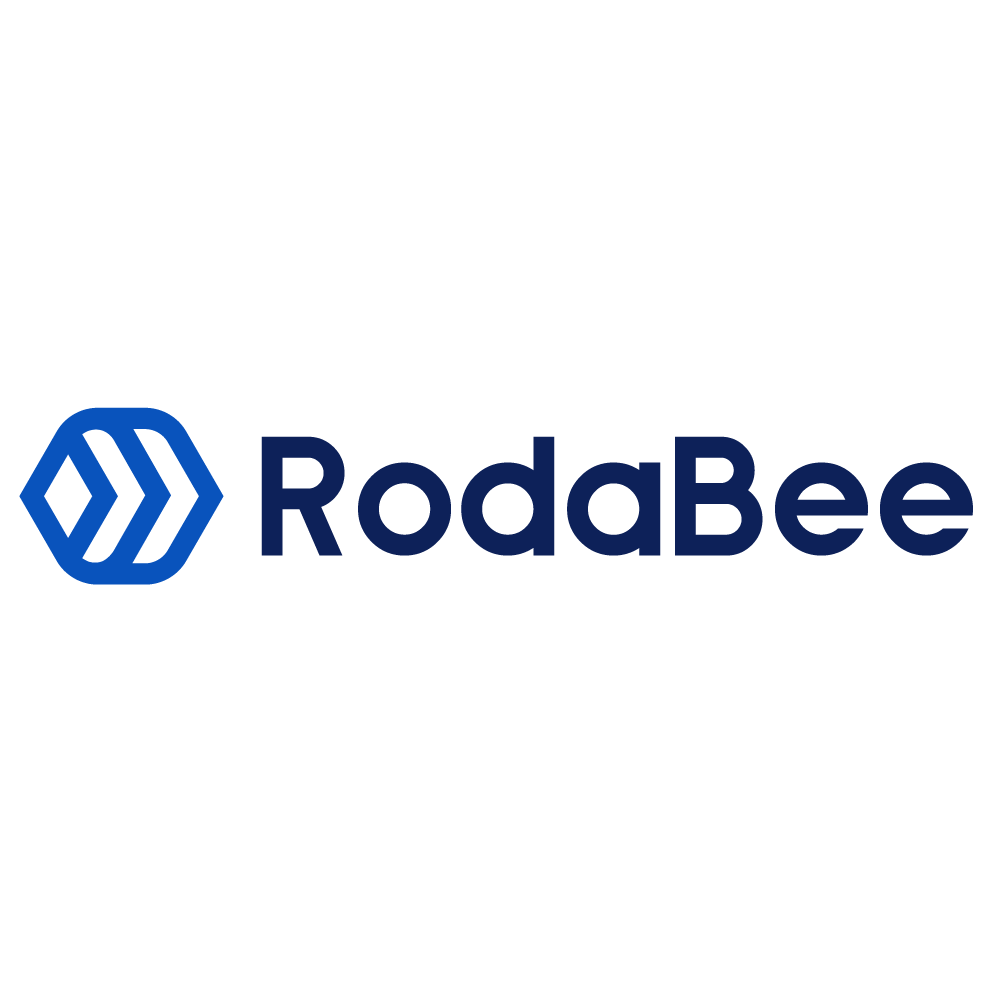

# RodaBee

RodaBee's engineering platform for the Dominican Republic: a unified storefront
and backoffice, a Go API and a shared PostgreSQL data model.

## Product and infrastructure

- [`web`](https://github.com/rodabee/web) — storefront and backoffice in one
  SvelteKit application, one build and one frontend service. Default branch: `v3`.
- [`api`](https://github.com/rodabee/api) — Go backend with GraphQL, PostgreSQL,
  authentication, catalog, business operations and integrations. Default branch: `v3`.
- [`infra`](https://github.com/rodabee/infra) — Terraform alternatives for GCP and
  AWS: API, unified web, PostgreSQL and object storage. Default branch: `main`.

## Migration and operations

- [`db-migration`](https://github.com/rodabee/db-migration) — data/media migration
  and verification tools; not a running application service.
- [`cutover`](https://github.com/rodabee/cutover) — production transition,
  reconciliation and rollback handbook.
- [`migration-plan`](https://github.com/rodabee/migration-plan) — architecture
  decisions, roadmap, migration history and cost/performance planning.

The infrastructure targets are alternatives, not automatic cross-cloud failover.
Migration checks and production acceptance are tracked in the engineering repos;
the consolidated architecture does not by itself certify every workflow or cutover.

## Archived references

[`buyers-web`](https://github.com/rodabee/buyers-web) and
[`backoffice`](https://github.com/rodabee/backoffice) are replaced by `web`.
[`rodabee-backend`](https://github.com/rodabee/rodabee-backend) is replaced by `api`.
[`faas`](https://github.com/rodabee/faas) preserves obsolete MongoDB replication
functions. Their histories remain available for comparison; active development
belongs in the current repositories above.

## Website

[rodabee.com](https://rodabee.com/)
